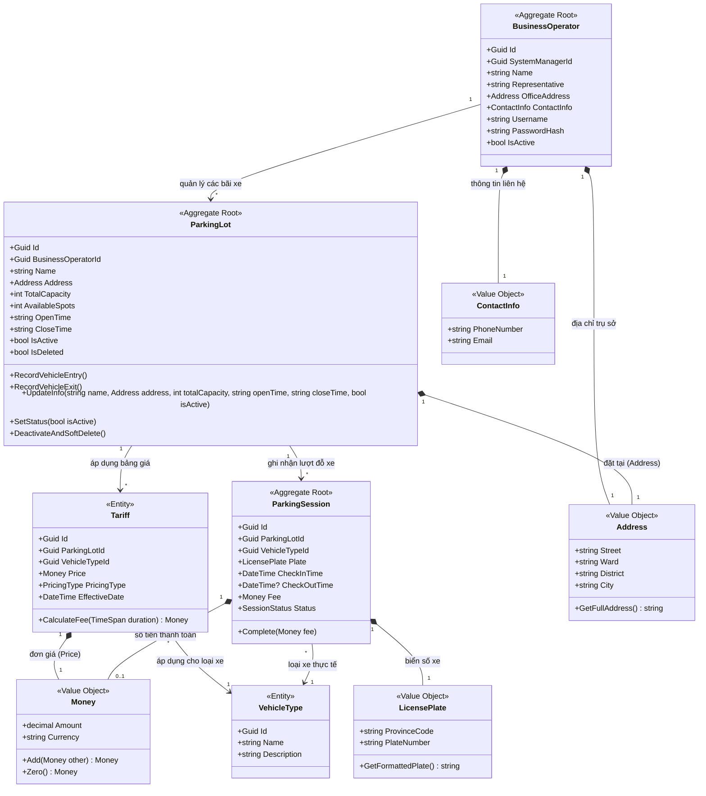
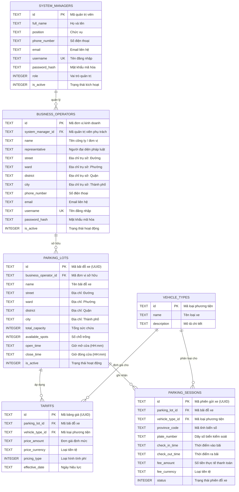
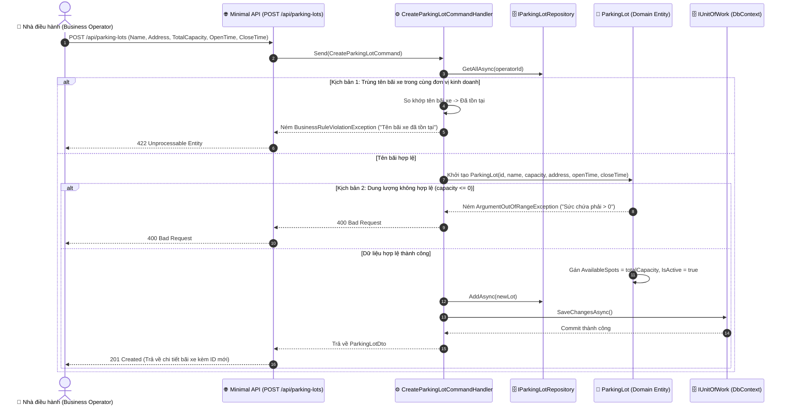
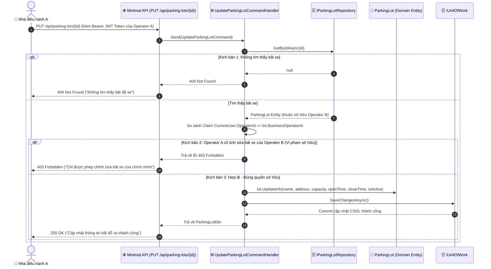
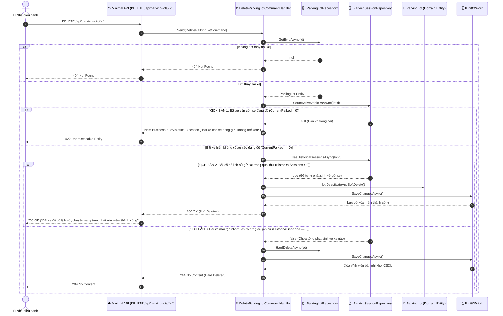

# TÀI LIỆU THIẾT KẾ KỸ THUẬT CHI TIẾT (LOW-LEVEL DESIGN - LLD)
## Phân hệ: Quản lý Thông tin Bãi đỗ xe (Smart Parking System)

---

## 1. Tổng quan phân hệ & Kiến trúc hệ thống

Phân hệ **Quản lý Thông tin Bãi đỗ xe** được thiết kế dựa trên các nguyên lý cốt lõi:
* **Domain-Driven Design (DDD):** Phân định rõ ranh giới giữa Aggregate Root, Entity, Value Object và các quy tắc nghiệp vụ bất biến (Invariants).
* **Clean Architecture / CQRS:** Độc lập giữa Domain Logic, Use Cases (Application), Cơ sở dữ liệu và Giao diện API.
* **Cơ chế phân quyền & kiểm tra sở hữu (Ownership Enforcement):** Đảm bảo tính bảo mật và toàn vẹn dữ liệu đa khách hàng (Multi-tenant).

---

## 2. Sơ đồ lớp (Class Diagram - Domain Model DDD)

### 2.1. Sơ đồ Mermaid Class Diagram

### 2.2. Đặc tả chi tiết các phần tử trong Mô hình Miền (Domain Model)

| Phân loại | Tên phần tử | Kiểu | Mô tả vai trò & Quy tắc nghiệp vụ |
| :--- | :--- | :--- | :--- |
| **Aggregate Root** | `BusinessOperator` | Lớp gốc | Đại diện cho đối tác / đơn vị vận hành bãi xe. Quản lý thông tin pháp nhân và danh mục bãi đỗ thuộc quyền sở hữu. |
| **Aggregate Root** | `ParkingLot` | Lớp gốc | Quản lý thông tin vật lý của bãi đỗ, sức chứa (`totalCapacity`), số chỗ trống thực tế (`availableSpots`), giờ mở cửa (`openTime`) và giờ đóng cửa (`closeTime`). |
| **Aggregate Root** | `ParkingSession` | Lớp gốc | Quản lý vòng đời lượt gửi xe từ lúc Check-in đến khi thanh toán Check-out. |
| **Entity** | `Tariff` | Thực thể | Chính sách giá đỗ xe áp dụng cho từng loại phương tiện tại bãi. |
| **Entity** | `VehicleType` | Thực thể | Danh mục phân loại phương tiện (Xe máy, Ô tô con, Xe tải). |
| **Value Object** | `Address` | Đối tượng giá trị | Gói thông tin địa chỉ gồm: `Street`, `Ward`, `District`, `City`. Không thể tách rời. |
| **Value Object** | `ContactInfo` | Đối tượng giá trị | Thông tin liên lạc (Số điện thoại, Email) có validation định dạng. |
| **Value Object** | `LicensePlate` | Đối tượng giá trị | Biển số xe gồm Mã tỉnh/thành (`ProvinceCode`) và Dãy số đăng ký (`PlateNumber`). |
| **Value Object** | `Money` | Đối tượng giá trị | Đơn vị tiền tệ chuẩn (Số tiền thập phân và Mã tiền tệ `VND`). |

---

## 3. Sơ đồ cơ sở dữ liệu (ERD) & Dữ liệu lưu trữ

### 3.1. Sơ đồ quan hệ thực thể (Mermaid ERD)

---

### 3.2. Dữ liệu lưu trữ (Database Schema Data Dictionary)

#### Bảng: `parking_lots` (Bảng chính lưu trữ thông tin bãi đỗ xe)

| STT | Tên cột | Kiểu dữ liệu | Khóa chính (PK) | Khóa ngoại (FK) | Nullable | Giá trị mặc định | Mô tả chi tiết |
| :---: | :--- | :--- | :---: | :---: | :---: | :---: | :--- |
| 1 | `id` | TEXT (UUID) | PK | | Không | | Mã định danh duy nhất của bãi đỗ xe. |
| 2 | `business_operator_id`| TEXT (UUID) | | FK | Không | | Khóa ngoại tham chiếu tới `business_operators(id)`. |
| 3 | `name` | TEXT (VARCHAR 150) | | | Không | | Tên bãi đỗ xe (Duy nhất trong cùng đơn vị kinh doanh). |
| 4 | `street` | TEXT (VARCHAR 255) | | | Không | | Địa chỉ số nhà, tên đường bãi xe tọa lạc. |
| 5 | `ward` | TEXT (VARCHAR 100) | | | Không | | Phường / Xã. |
| 6 | `district` | TEXT (VARCHAR 100) | | | Không | | Quận / Huyện / Thị xã. |
| 7 | `city` | TEXT (VARCHAR 100) | | | Không | | Tỉnh / Thành phố trực thuộc trung ương. |
| 8 | `total_capacity` | INTEGER | | | Không | | Tổng số lượng vị trí đỗ xe thiết kế (`total_capacity > 0`). |
| 9 | `available_spots` | INTEGER | | | Không | | Số lượng vị trí còn trống sẵn sàng tiếp nhận xe (`0 <= available_spots <= total_capacity`). |
| 10 | `open_time` | TEXT (CHAR 8) | | | Không | `'06:00'` | Khung giờ mở cửa hoạt động hàng ngày (`HH:mm`). |
| 11 | `close_time` | TEXT (CHAR 8) | | | Không | `'22:00'` | Khung giờ đóng cửa hoạt động hàng ngày (`HH:mm`). |
| 12 | `is_active` | INTEGER (TINYINT) | | | Không | `1` | Trạng thái hoạt động: `1` (Đang mở đón khách), `0` (Tạm ngưng phục vụ). |

#### Bảng: `business_operators` (Đơn vị kinh doanh / Chủ sở hữu bãi đỗ)

| STT | Tên cột | Kiểu dữ liệu | Khóa chính (PK) | Khóa ngoại (FK) | Nullable | Giá trị mặc định | Mô tả chi tiết |
| :---: | :--- | :--- | :---: | :---: | :---: | :---: | :--- |
| 1 | `id` | TEXT (UUID) | PK | | Không | | Mã định danh đơn vị kinh doanh. |
| 2 | `system_manager_id` | TEXT (UUID) | | FK | Không | | Quản trị viên hệ thống phê duyệt / phụ trách. |
| 3 | `name` | TEXT (VARCHAR 200) | | | Không | | Tên doanh nghiệp / Đơn vị vận hành bãi xe. |
| 4 | `representative` | TEXT (VARCHAR 100) | | | Không | | Người đại diện theo pháp luật. |
| 5 | `street` | TEXT (VARCHAR 255) | | | Không | | Địa chỉ trụ sở văn phòng. |
| 6 | `ward` | TEXT (VARCHAR 100) | | | Không | | Phường / Xã. |
| 7 | `district` | TEXT (VARCHAR 100) | | | Không | | Quận / Huyện. |
| 8 | `city` | TEXT (VARCHAR 100) | | | Không | | Tỉnh / Thành phố. |
| 9 | `phone_number` | TEXT (VARCHAR 20) | | | Không | | Số điện thoại liên hệ chính thức. |
| 10 | `email` | TEXT (VARCHAR 100) | | | Không | | Địa chỉ hòm thư điện tử. |
| 11 | `username` | TEXT (VARCHAR 50) | | | Không | | Tên đăng nhập hệ thống (Unique). |
| 12 | `password_hash` | TEXT (VARCHAR 255) | | | Không | | Mật khẩu tài khoản đã mã hóa bcrypt. |
| 13 | `is_active` | INTEGER (TINYINT) | | | Không | `1` | Trạng thái hoạt động (`1`: Đang hoạt động, `0`: Bị khóa). |

---

## 4. Sơ đồ tuần tự (Sequence Diagrams)

### 4.1. Luồng 1: Khởi tạo bãi đỗ xe mới (Create Parking Lot)

---

### 4.2. Luồng 2: Cập nhật thông tin & Kiểm tra quyền sở hữu (Update Parking Lot - Ownership Check)

---

### 4.3. Luồng 3: Phân nhánh xóa bãi đỗ xe (Delete Parking Lot)

